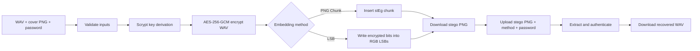

# CIPHER FRAME

**Secure Audio-in-Image Steganography Workstation**

**Repository:** https://github.com/PranavKoodanda/cipher-frame  
**Live frontend:** https://audio-image-steganography.vercel.app/

Cipher Frame is a full-stack educational and technical workstation that **encrypts a PCM WAV audio file and embeds the encrypted payload in a PNG image**, then recovers the audio using the correct password and embedding method. It also provides image forensics to help explain how embedding affects image data.

> **Security scope:** Encryption provides confidentiality and authenticated tamper detection. Steganography does **not** guarantee undetectability. Changing or re-encoding the carrier image may destroy hidden data.

## Features

### Secure embedding and recovery
- **AES-256-GCM** authenticated encryption with a fresh random salt and nonce per operation.
- **Scrypt** password-based key derivation.
- Two embedding methods:
  - **PNG Custom Chunk:** stores the encrypted envelope in a custom `stEg` PNG chunk before `IEND`, without modifying decoded image pixels.
  - **LSB:** stores encrypted bits in the least-significant bits of RGB pixel channels; image capacity depends on dimensions and payload size.
- Decode & Recover workflow extracts and authenticates the encrypted payload, then downloads the original WAV.
- Workbench shortcut to reuse a newly generated stego PNG in Decode; the password must be entered again.
- Input validation, authentication failure handling, payload integrity checks, and upload size limits (20 MiB per WAV/PNG file by default).

### Six-page forensic workstation
| Page | Purpose |
| --- | --- |
| **Workbench** | Upload WAV + cover PNG, choose PNG Chunk/LSB, encrypt and embed, inspect execution status, download the stego PNG. |
| **Histogram Analysis** | Inspect individual RGB/grayscale distributions or compare cover and stego histograms; review measured image differences. |
| **Pixel Lab** | Inspect actual RGBA values in the same 8×8, 16×16, or 32×32 region of cover/stego images, including per-pixel change indicators. |
| **Decode & Recover** | Upload a stego PNG, select its method, enter the password, and recover a WAV; optionally provide the original cover for comparison. |
| **Performance** | View backend processing-stage timings and frontend elapsed-time measurements. |
| **Run History** | Review locally stored metadata about completed and failed operations. |

### Image analysis
- **Single-image mode:** actual RGB/grayscale histograms and pixel inspection remain available with just one PNG.
- **Two-image mode:** compares decoded RGBA image data, RGB histogram distributions, pixel equality/changes, selected regions, image-quality metrics, and decoded-pixel hashes.
- **Difference map lives in Histogram Analysis:** per-pixel maximum absolute RGB-channel difference, on an actual **0–255** scale.
- **Optional visual amplification:** 1× (actual), 10×, or 50× display brightness, using `min(255, D × factor)`; changing the visual factor never changes the measured differences, MSE, PSNR, or changed-pixel counts.
- **Pixel Lab** retains the detailed original/stego pixel matrices rather than duplicating the full-image difference map.
- PNG Chunk should preserve decoded pixels (zero pixel difference). LSB commonly modifies low-order RGB channel values; image-quality metrics are **not evidence of steganographic undetectability**.

## How it works



### Method comparison
| Aspect | PNG Custom Chunk | LSB |
| --- | --- | --- |
| Data location | `stEg` ancillary chunk before `IEND` | RGB channel least-significant bits |
| Decoded pixels | Unchanged | May change slightly |
| Capacity | Depends on file/container handling | Depends on pixel count and envelope length |
| Main fragility | Chunk-stripping or file processing | Resizing, re-encoding, recompression and pixel modification |
| Detectability | Custom chunk may be inspected | Statistical steganalysis may detect modifications |

## Architecture and technology

- **Frontend:** React 19, Vite 6, plain CSS; Vitest and React Testing Library.
- **Backend:** Python, FastAPI, Uvicorn, `python-multipart`.
- **Cryptography:** `cryptography` library, AES-256-GCM, Scrypt.
- **Image analysis:** Pillow and custom PNG chunk handling.
- **Testing:** pytest (backend), Vitest (frontend).

```text
cipher-frame/
├── backend/
│   ├── app/
│   │   ├── core/                 # encryption, envelope, validation
│   │   ├── services/             # hide/recover workflow
│   │   ├── stego/                # PNG Chunk and LSB algorithms
│   │   ├── utils/                # hashing, image metrics, pixel analysis
│   │   └── main.py               # FastAPI endpoints
│   ├── tests/
│   └── requirements.txt
├── frontend/
│   ├── src/
│   │   ├── App.jsx               # six-page workstation
│   │   ├── api.js                # FastAPI client
│   │   ├── differenceMap.js      # visual amplification helper
│   │   ├── singleImageAnalysis.js# client-side single-PNG analysis
│   │   └── styles.css            # dark forensic theme
│   ├── package.json
│   └── vite.config.js
└── README.md
```

## Run locally (Windows PowerShell)

**1. Start the backend from the repository root**

```powershell
python -m venv backend\.venv
.\backend\.venv\Scripts\python.exe -m pip install -r backend\requirements.txt
.\backend\.venv\Scripts\python.exe -m uvicorn backend.app.main:app --reload --host 127.0.0.1 --port 9000
```

API health: http://127.0.0.1:9000/api/health  
Interactive API docs: http://127.0.0.1:9000/docs

**2. Start the frontend in a second terminal**

```powershell
cd frontend
npm install
npm run dev
```

Vite normally runs at http://localhost:5173 and proxies `/api` to `http://127.0.0.1:9000` in development. To target a different deployed API, configure `VITE_API_BASE_URL` in `frontend/.env` (do not store passwords there).

## API endpoints

| Method | Endpoint | Purpose |
| --- | --- | --- |
| GET | `/api/health` | API availability (`{"status":"ok"}`) |
| POST | `/api/hide` | Upload `wav`, `image`, `password`, `method` (`chunk` / `lsb`); return `image/png` |
| POST | `/api/recover` | Upload `image`, `password`, `method`; return `audio/wav` |
| POST | `/api/analyze` | Upload `original`, `stego`, optionally `region_x`, `region_y`, `region_size`; return RGBA comparison and analysis JSON |

`/api/hide` and `/api/recover` return measured stage data in `X-Workflow-Timings`. Invalid input and out-of-bounds regions yield controlled errors; incorrect password/authentication failure is reported separately. Refer to FastAPI `/docs` for current request schemas.

## Testing and verified results

From the repository root:

```powershell
.\backend\.venv\Scripts\python.exe -m pytest backend\tests
cd frontend
npm test -- --run
npm run build
```

**Latest user-reported local verification (November 2026):**

| Check | Result |
| --- | --- |
| Backend pytest | **54 passed**; one Starlette/httpx deprecation warning |
| Frontend Vitest | **27 passed** across 3 test files |
| Vite production build | **Successful** |
| Total automated tests | **81 passed** |

These are recorded local results, not a guarantee about every environment or a separately verified deployed system.

## Security and operational limitations

1. The password and embedding method are required to recover the payload; passwords are not persisted in Run History.
2. AES-GCM authenticates encrypted content; a PNG CRC or LSB checksum is not a cryptographic substitute for it.
3. PNG transformations, ancillary-chunk stripping, recompression, and resizing may break recovery.
4. LSB capacity is finite; an encrypted WAV may exceed the selected carrier's capacity.
5. Histogram similarity, MSE and PSNR do not establish resistance to steganalysis.
6. Browser Run History stores operation metadata locally; it is not a server-side audit log.
7. Production deployment should include HTTPS, access control, resource limits and operational monitoring.

## Documentation and screenshots

For an academic submission, add current screenshots of the six workstation pages to `docs/screenshots/` and link them here. Older screenshot paths from the previous interface should not be presented as current visuals.

## Future work

- Controlled deployment and reproducible container setup.
- Improved usability and accessibility testing with representative real-world image/audio inputs.
- Optional steganalysis and capacity-estimation modules, clearly separated from cryptographic security guarantees.
